# Network Reliability and GSL Compliance Analytics


**An end to end reliability and compliance analytics project: validate outage data before it reaches a calculation, rebuild a distributor's Major Event Day threshold from its published data, reproduce its STPIS targets, and reconcile its Guaranteed Service Level payments against the regulator's figures.**

Built in SQL Server and Power BI on real, publicly published regulatory data. This is an independent portfolio project. It is not affiliated with, endorsed by, or produced for any distributor or regulator.

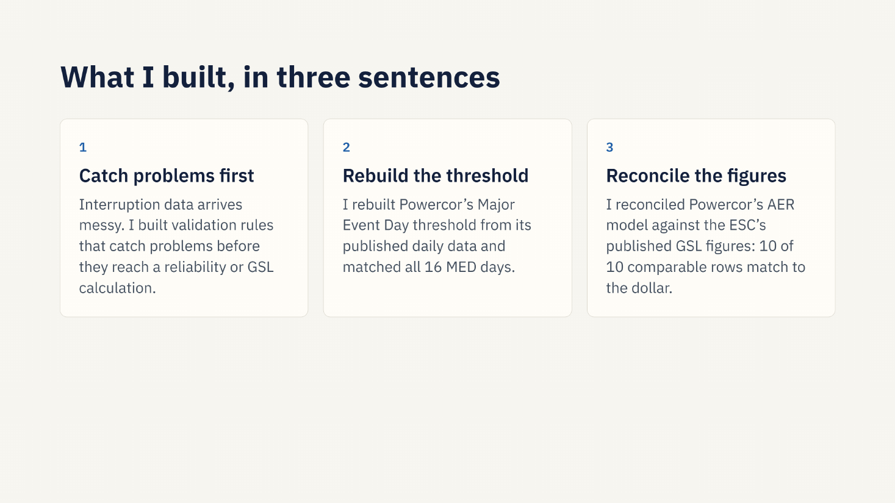

---

## Results at a glance

| Area | Result |
|---|---|
| Outage events validated | **37,538** New Zealand interruption events, 29 distributors |
| Exceptions logged before any calculation | **870** exceptions across **868** events (2.3%) |
| Largest data issue | **617** exact duplicate rows, all Westpower, doubling its SAIDI (**369.1** vs **184.56** cleaned) |
| False alarm avoided | A naive 5% customer minutes rule would raise about **12,900** alerts, about **99%** false. **89** events are real errors |
| Major Event Day threshold | Rebuilt at **6.759** minutes from **1,827** days of Powercor data, **16 of 16** MED days match |
| STPIS targets | Reproduced exactly: Urban **56.378**, Short Rural **94.273**, Long Rural **208.154** |
| GSL reconciliation | **10 of 10** comparable category rows match the ESC to the dollar, FY22 and FY23 actuals |

---

## Architecture

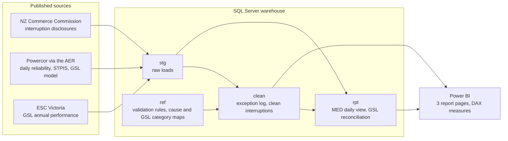

| Layer | Key objects |
|---|---|
| `stg` | `stg.nz_interruptions`, `stg.pcr_daily_reliability`, `stg.pcr_gsl_model`, `stg.esc_gsl` |
| `ref` | `ref.validation_rules`, `ref.cause_mapping`, `ref.gsl_category_mapping` |
| `clean` | `clean.exception_log`, `clean.interruptions` |
| `rpt` | `rpt.pcr_daily_med`, `rpt.gsl_reconciliation` |

The Power BI model uses Import mode with single direction relationships: Events to Exceptions on `load_row_id`, and Rules to Exceptions on `rule_id`.

---

## 1. Data quality: catch problems before they reach a calculation

A rules catalogue (`ref.validation_rules`) drives the checks, and every failure is written to `clean.exception_log` with its rule and severity rather than silently dropped. Control totals tie out: **36,911** clean rows plus **627** excluded critical rows equals the **37,538** loaded.

| Rule | Check | Status |
|---|---|---|
| V01 | End before or equal to start | Applied (10) |
| V02 | Suspected day and month swap | Designed, not applied |
| V03 | Extreme duration | Applied (75) |
| V04 | Missing or zero customers | Applied (31) |
| V05 | Fractional customer count | Applied (35) |
| V06 | Customer minutes mismatch | Designed, not applied |
| V07 | Exact duplicate records (`ROW_NUMBER`) | Applied (617) |
| V08 | Momentary event in sustained data | Applied (102) |

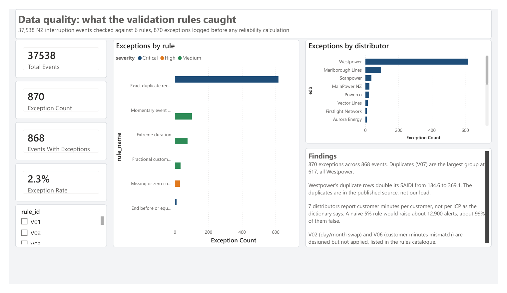

### The customer minutes trap

The data dictionary says customer minutes are reported per ICP. Seven distributors actually report them per customer. A naive rule that flags any mismatch over 5% would raise about 12,900 alerts, about 99% of them false. Only 89 events report more customer minutes than is physically possible, and those are the real errors. Rule V06 is therefore designed but held back until it can account for reporting basis and staged restoration.

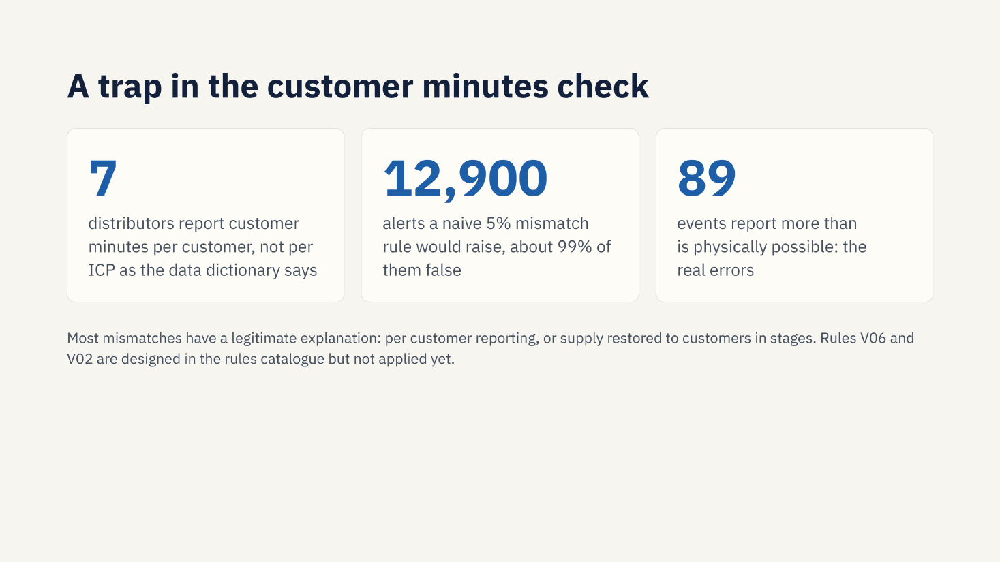

---

## 2. Reliability: rebuilding the Major Event Day threshold

Major Event Days (MEDs) are storm days excluded from reliability performance. The threshold is calculated from the natural log of daily SAIDI:

```
alpha     = mean of ln(daily SAIDI)        = -2.0113
beta      = standard deviation             =  1.4008
threshold = e^(alpha + 2.8 x beta)         =  6.759 minutes
```

Across 1,827 days, every one of Powercor's 16 published MED days is reproduced, with no mismatches. Exclusions are applied before a day is tested: on 31 January 2020 raw SAIDI was 6.984, above the threshold, but 3.950 after exclusions, so it is not a MED.

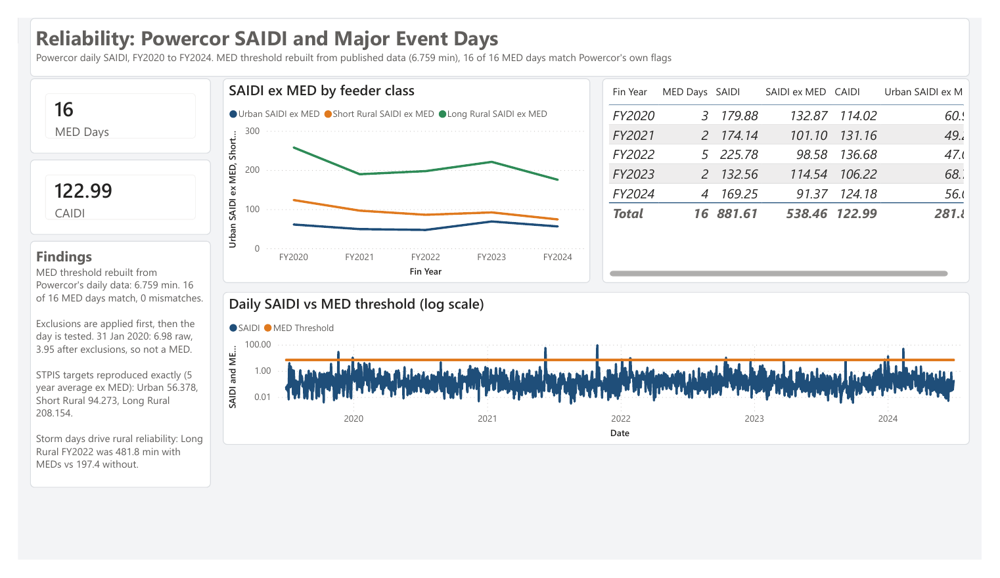

### STPIS targets

The AER reliability targets are reproduced exactly as five year averages with MED days removed. Keeping the MED days in would inflate them sharply, which shows how much rural performance depends on storm days: Long Rural FY2022 was 481.8 minutes with MED days and 197.4 without, so about 59% of those outage minutes fell on storm days.

| Feeder class | Target (MED days removed) | Average if MED days kept |
|---|---|---|
| Urban | 56.378 | 72.8 |
| Short Rural | 94.273 | 150.9 |
| Long Rural | 208.154 | 376.5 |

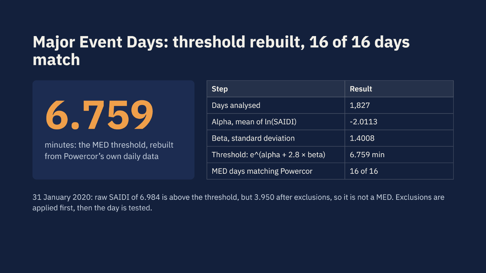

---

## 3. Compliance: GSL reconciliation

Powercor's GSL model submitted to the AER (MOD 9.04) is reconciled against the Essential Services Commission's published GSL figures with a `FULL OUTER JOIN` on a shared category map (`rpt.gsl_reconciliation`). Tolerance is $1 and 0.5 count.

* **10 of 10** comparable category rows match to the dollar for FY22 and FY23 actuals.
* **Scope difference, not an error:** street lights appear only in Powercor's model ($750 FY22, $575 FY23, $1,325 in total) because the ESC does not publish them.
* **Internal check:** rate x count = amount on every actual row, with 0 exceptions.
* **Label trap:** Powercor's "Low reliability" hours based payments correspond to the ESC's "Supply restoration" category, so categories were mapped by meaning, not by wording.
* **Storm link:** MED day GSL count was 27,479 in FY22 against 7,579 in FY23, consistent with 5 MED days against 2.

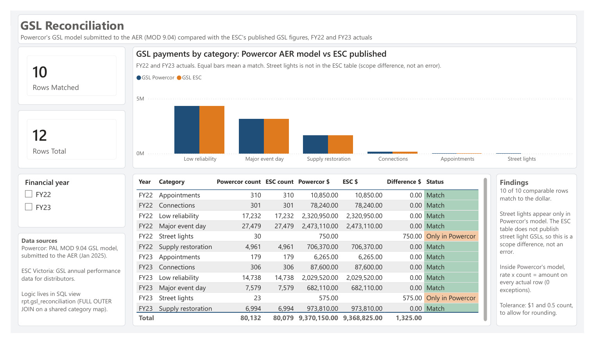

---

## Slide summary

The full deck is in [`docs/project-summary.pdf`](docs/project-summary.pdf).

| | |
|---|---|
| 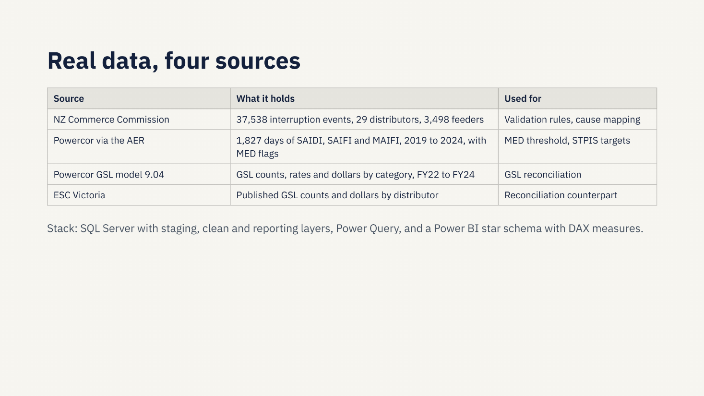 | 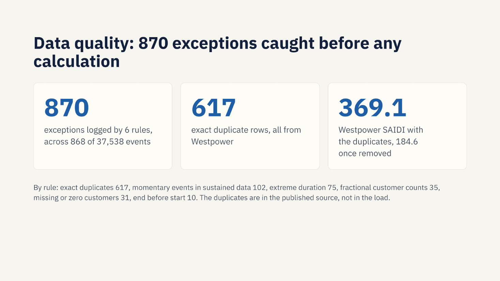 |
| 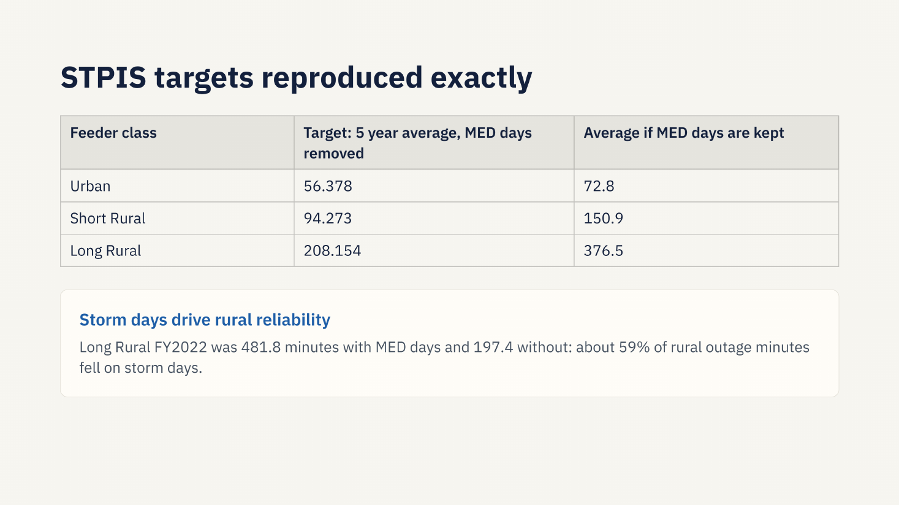 | 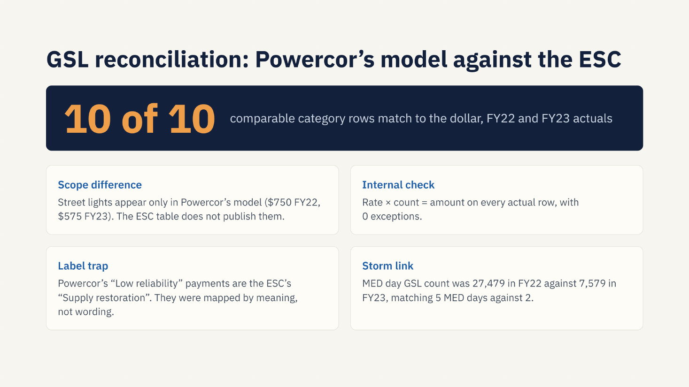 |
| 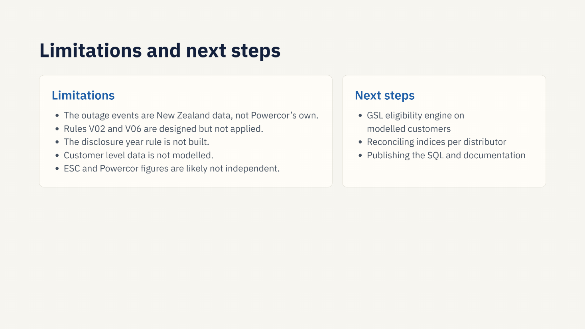 | |

---

## Repository structure

```
.
├── sql/                     Numbered T-SQL scripts, run in order
│   ├── 00_create_database.sql
│   ├── 01_load_checks.sql
│   ├── 02_profiling.sql
│   ├── 03_rules_catalogue.sql
│   ├── 04_apply_rules.sql
│   ├── 05_cause_mapping.sql
│   ├── 06_clean_view.sql
│   ├── 07_med_threshold.sql
│   └── 08_gsl_reconciliation.sql
├── powerbi/                 Report (.pbix), theme and PDF export
├── data/
│   ├── csv/                 Extracts loaded into SQL Server
│   ├── nz/                  NZ Commerce Commission disclosures
│   └── powercor/            Powercor regulatory templates via the AER
└── docs/
    ├── images/              Report pages and summary slides
    └── project-summary.pdf  Slide summary of the project
```

## How to run

1. Run `sql/00_create_database.sql` on SQL Server (built and tested on SQL Server 2022 Express).
2. Load the files in `data/csv` into the matching `stg` tables, then run scripts `01` to `08` in order. `01_load_checks.sql` confirms row counts after loading.
3. Open `powerbi/Powercor_Reliability.pbix` in Power BI Desktop and point the data source at your own SQL Server instance.

## Data sources

| Data | Publisher |
|---|---|
| Interruptions, worst feeders and data dictionary (`data/nz`) | New Zealand Commerce Commission, electricity distributor information disclosure |
| STPIS targets and incentives, GSL model, REFCL reliability, worst served customers (`data/powercor`) | Powercor Australia, published through the Australian Energy Regulator |
| GSL annual performance data for distributors (`data/esc_2024-25_gsl_annual_performance.docx`) | Essential Services Commission, Victoria |

All files are reproduced as published for analysis. Check each publisher's terms before reusing them.

## Limitations and next steps

**Limitations**

* The outage event data is New Zealand data, not Powercor's own. Powercor's files cover daily reliability, targets and GSL.
* Rules V02 and V06 are designed but not applied.
* The regulatory disclosure year rule is not built.
* Customer level data is not modelled.
* ESC and Powercor figures are likely not independent sources, so a match is a consistency check rather than proof.

**Next steps**

* A GSL eligibility engine on modelled customer data.
* Reconciling reliability indices per distributor.

## Glossary

| Term | Meaning |
|---|---|
| SAIDI | Average minutes off supply per customer |
| SAIFI | Average number of interruptions per customer |
| CAIDI | SAIDI divided by SAIFI, the average length of one interruption |
| MED | Major Event Day, a storm day assessed separately using a statistical threshold |
| STPIS | AER Service Target Performance Incentive Scheme |
| GSL | Guaranteed Service Level payments to customers who receive poor service |
| REFCL | Rapid Earth Fault Current Limiter, a bushfire mitigation device |
| ICP | Installation Control Point, the NZ term for a customer connection |
| AER / ESC | Australian Energy Regulator / Essential Services Commission (Victoria) |

## Author

**Anson Sebastian**, Melbourne. Reporting Analyst, Master of Data Science (Deakin University).
GitHub: [anson4747](https://github.com/anson4747)
